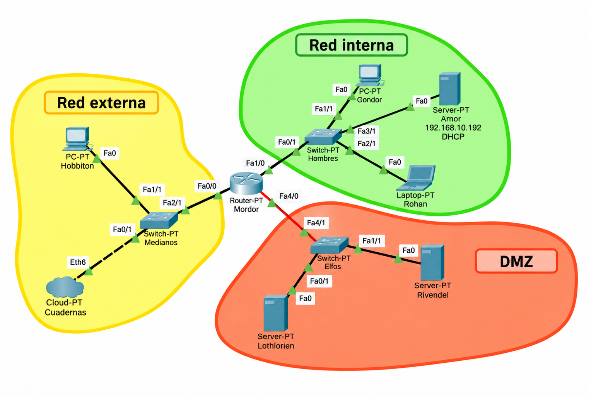

# 🌐 Servicios de Red e Internet · ASIR

## Material docente integral · `ASIR2-SRI-texto` · v6.6.5

**Edición 2026** para el módulo profesional **0375 · Servicios de red e Internet** del **CFGS Técnico Superior en Administración de Sistemas Informáticos en Red (ASIR)**.

Este repositorio se concibe como un sistema completo de aprendizaje y operación técnica: **teoría → laboratorio → diagnóstico → evaluación → documentación → transferencia profesional**.

## Qué encontrarás en esta edición

Cada UT integra objetivos observables, mapa conceptual, activación de conocimientos previos, analogías, conceptos con definiciones contextuales, rutas de aprendizaje, prácticas guiadas/semiguiadas/autónomas, incidencias, diagnóstico sistemático, evidencia, rúbricas, autoevaluación, test, solucionario y recursos de ampliación.

Se añaden además plantillas profesionales, matriz curricular, guía de laboratorio reproducible, auditoría de obsolescencia, índice alfabético y un algoritmo reproducible de actualización.

## Unidades de trabajo y correspondencia curricular

La correspondencia entre las unidades de trabajo y los resultados de aprendizaje se establece según el contenido y el desempeño evaluable del módulo profesional **0375 · Servicios de red e Internet**.

| UT | RA |
|---|---|
| **UT1** | — |
| **UT2** | **RA2** |
| **UT3** | **RA1** |
| **UT4** | **RA3** |
| **UT5** | **RA4** |
| **UT6** | **RA5** |
| **UT7** | **RA6** |
| **UT8** | **RA7 + RA8** |

La correspondencia se contrasta con el currículo básico estatal del título y con el currículo de Castilla y León para el módulo 0375.

**Referencias normativas:** [Orden EDU/1287/2024, de 26 de noviembre — currículo de ASIR en Castilla y León](https://bocyl.jcyl.es/boletines/2024/12/02/pdf/BOCYL-D-02122024-3.pdf) · [Real Decreto 1629/2009, de 30 de octubre — título y enseñanzas mínimas](https://www.boe.es/buscar/doc.php?id=BOE-A-2009-19218).

## Índice general

Consulta el **[índice general](INDICE-GENERAL.md)** para acceder directamente a todas las UT, anexos y materiales complementarios.

## Novedad v6.6.4 · Ejemplos de Kea ejecutables

Los ejemplos de Kea de la UT2 son ahora ficheros `kea-dhcp4.conf` completos que pasan `kea-dhcp4 -t` con Kea 3.0 (Ubuntu 26.04): todas las subredes llevan su `id`, obligatorio desde Kea 2.6. Detalle en [CHANGELOG-v6.6.4.md](CHANGELOG-v6.6.4.md).

## Novedad v6.6.3 · Simulador de redes

El Entorno I pasa a llamarse **Simulador de redes**, sin atarse a un producto. Opciones, por orden:

| Opción | Tipo y licencia | Posibilidades | Enlaces |
|---|---|---|---|
| **1 · Netfix** (recomendado) | Web, sin instalación ni cuenta; libre (código GPL-3.0-or-later, documentación CC BY-SA 4.0) | CLI de Cisco IOS con servidor DHCP completo (reservas, relay, snooping), NAT/PAT y ACL estándar, gestión web de routers y switches; servidores con DHCP (reservas por MAC o Client-ID), DNS, Apache2, correo SMTP/POP3/IMAP con Roundcube y SSH; terminales GNU/Linux (bash 5.3) y Windows; nube ISP con Internet emulada y DNS públicos 8.8.8.8/8.8.4.4; modo simulación paquete a paquete | [Abrir Netfix Lab](https://raw.githack.com/glopezca/netfix/main/demo/netfix-lab.html) · [Repositorio y documentación](https://github.com/glopezca/netfix) |
| **2 · Cisco Packet Tracer** | Aplicación de escritorio (Windows, Linux y macOS); gratuita con cuenta de Cisco Networking Academy; propietaria | Simulación de routers y switches Cisco IOS, servidores con servicios básicos (DHCP, DNS, HTTP, Email, FTP/TFTP), IoT y modo Simulación; actividades evaluables `.pka` | [Página oficial](https://www.netacad.com/cisco-packet-tracer) |
| **3 · GNS3** | Escritorio con servidor local o máquina virtual GNS3 (Windows, macOS y Linux); libre (GPL-3.0) | **Emulación** con imágenes reales: Cisco IOSv/IOSvL2 o Dynamips (las imágenes las aporta el usuario), contenedores Docker y VMs QEMU (Linux y otros fabricantes); puede conectarse a redes reales; necesita más recursos | [gns3.com](https://www.gns3.com/) · [Descargas](https://gns3.com/software) · [Documentación](https://docs.gns3.com/) · [GitHub](https://github.com/GNS3) |
| **4 · Boson NetSim** | Web (navegador); comercial, suscripción anual | Simulador orientado a certificaciones Cisco (CCNA 200-301, CCNP ENCOR y ENARSI) con laboratorios guiados y corregidos | [Página oficial](https://boson.com/netsim-cisco-network-simulator/) |

Comparativa, criterio de uso y correspondencia con las prácticas en el [Anexo XXII · Simulador de redes](ANEXO-XXII-Simulador-de-redes.md). El antiguo simulador web **netsim** se llama ahora **Netfix**; sus enlaces están actualizados.

## Novedad v6.6.2 · Netfix con Server en UT2, UT3, UT4 y UT6

**Netfix** es un simulador web, sin instalación, que se usa como Simulador de redes o como apoyo de otro. Reúne:
- la CLI de Cisco IOS con servidor DHCP completo;
- servidores tipo Server con DHCP (con reservas por MAC), DNS, HTTP, correo SMTP/POP3/IMAP y SSH;
- terminales GNU/Linux (`systemctl`, `journalctl`, `ip`, `dig`, `curl`) y Windows, en servidores y PC.

Cada unidad lo enlaza donde otro simulador se queda corto:

| Unidad | Para qué se usa Netfix |
|---|---|
| UT2 | Completar las reservas DHCP, tanto en Arnor (gráfico) como en Mordor (IOS) |
| UT3 | Ver las consultas DNS paquete a paquete |
| UT4 | Observar HTTP sobre TCP |
| UT6 | Seguir SMTP, POP3 e IMAP con reenvío por MX |

Acceso, correspondencia con las prácticas y usuarios de ejemplo en el [Anexo XXII](ANEXO-XXII-Simulador-de-redes.md).

## Corrección nftables/Webmin en v6.6

UT1 revisa la sintaxis de las cadenas base de `nftables` para mantener `type`, `hook`, `priority` y `policy` en una única sentencia. Esto conserva la sintaxis válida de `nftables` y evita que el módulo Linux Firewall (nftables) de Webmin trate una línea independiente `policy ...;` como si fuese una regla.

## Anexos incorporados en v6.6

- [Anexo XX · Scripts personalizados de ASIR2-SRI](ANEXO-XX-Scripts-Personalizados-ASIR2-SRI.md) — `apt.sh`, scripts de prompt Linux/PowerShell, `PATH`, persistencia, `chmod +x`, `batcat` y, después, Git como generalización.
- [Anexo XXI · Chuleta de utilidades TUI](ANEXO-XXI-Chuleta-TUI-Administracion.md) — clasificación por funcionalidad: procesos, red, contenedores, ficheros, logs, Git y administración remota; con btop, glances, iftop, bandwhich, k9s, lazydocker, ctop, lazygit, ncdu, broot, mc, tmux y byobu.

## Índice alfabético

Consulta el **[índice alfabético de conceptos](INDICE-ALFABETICO.md)** para localizar rápidamente términos, servicios, protocolos y conceptos trabajados en las UT.

## Tres entornos de trabajo + Docker como extensión

La v6.6 fija **tres entornos primarios y coherentes** para las prácticas: **Simulador de redes**, **WSL** y **VirtualBox + Ubuntu Server**. Docker Compose queda como extensión reproducible en los anexos y no sustituye al laboratorio principal.

| Entorno | Papel en v6.6 |
|---|---|
| 🧪 **Simulador de redes** | Topología, routing y demostración gráfica de DHCP; en UT2 se compara **Arnor (DHCP gráfico)** con **Mordor (DHCP por CLI)**. |
| 🐧 **WSL + Ubuntu** | Cliente, herramientas de diagnóstico, captura, consultas y automatización. **No se despliega un servidor DHCP en WSL.** |
| 🖥️ **VirtualBox + Ubuntu Server** | Servidores reales del laboratorio. Las cinco VMs son **Mordor, Gondor, Rohan, Lothlorien y Rivendel**. Mordor presta DHCP; Lothlorien centraliza la práctica de servicios; Rivendel se reserva para configuraciones auxiliares. |
| 🐳 **Docker Compose** | Extensión opcional para reproducibilidad, tratada en los anexos; no redefine la arquitectura principal. |

### Ecosistema Tierra Media v6.6

> **Esquema único del entorno de red:** se utiliza exclusivamente el PNG mejorado basado en la topología del Simulador de redes. No se incluye el SVG generado posteriormente.



| Zona | Red | Elementos principales | Papel |
|---|---|---|---|
| 🟨 **Red externa** | `10.0.0.0/16` | Hobbiton `10.0.32.64`, Mordor `10.0.2.15` | Acceso externo / salida |
| 🟩 **Red interna** | `192.168.10.0/24` | Mordor `192.168.10.254`, Gondor `.64`, Rohan `.65`, Arnor `.192` | Clientes y DHCP en el Simulador de redes |
| 🟧 **DMZ** | `192.168.20.0/24` | Mordor `192.168.20.254`, Lothlorien `.192`, Rivendel `.193` | Servicios publicados |

**Dominio de laboratorio:** `tierramedia.jc` · **DNS:** `192.168.20.192` · **DHCP gráfico en el simulador:** Arnor `192.168.10.192` · **DHCP CLI en el simulador:** Mordor `192.168.10.254`.

### VMs de VirtualBox

```text
Mordor       → router/gateway Linux + DHCP
Gondor       → cliente interno
Rohan        → cliente interno
Lothlorien   → servidor principal de servicios
Rivendel     → servidor auxiliar / secundario / pruebas
```

> **Regla de continuidad:** una UT posterior no inventa una red nueva si puede completar la infraestructura anterior. Cuando el servicio real se despliega en Ubuntu, se centraliza en **Lothlorien** salvo que el objetivo de la práctica exija específicamente **Mordor** o **Rivendel**.

## v6.6 · Cambio de arquitectura de laboratorio

La v6.6 fija una arquitectura acumulativa única para las ocho UT. El objetivo es que cada unidad **añada un servicio al mismo escenario**, no que reinicie el laboratorio con una topología distinta.

### Regla de oro de documentación técnica

Para **cada servicio** se exige:

1. ecosistema y equipo donde se instala;
2. ubicación exacta de los ficheros;
3. estructura y sintaxis del formato;
4. ejemplo mínimo;
5. configuración completa del caso Tierra Media;
6. guardado y persistencia;
7. batería de pruebas;
8. comprobación de sintaxis;
9. incorporación de comandos al glosario/chuleta;
10. módulo Webmin equivalente, cuando exista, y declaración expresa cuando no exista.

La matriz y la arquitectura completa están en [Anexo XIX](ANEXO-XIX-Arquitectura-Laboratorio-v6.6.md).

## Cómo está organizada cada UT

1. **Situación:** qué problema vas a resolver.
2. **Idea clave:** qué necesitas entender antes de tocar la configuración.
3. **Ejemplo:** cómo se hace en un caso sencillo.
4. **Práctica:** primero guiada, después con menos ayuda y finalmente autónoma.
5. **Diagnóstico:** qué hacer cuando el resultado no coincide con lo esperado.
6. **Evidencia:** qué debes enseñar para demostrar que funciona.
7. **Evaluación:** preguntas, pruebas y actividades.

La **preparación común de las prácticas aparece una sola vez en cada UT**. Cada práctica conserva únicamente sus **pistas específicas**.

## Laboratorio base

La preparación del entorno está en **UT1**, e incluye ficha del puesto, VirtualBox + Ubuntu Server 26.04 LTS, Netplan, SSH, WSL, Simulador de redes y orientación sobre Docker Compose. Los anexos contienen la profundidad específica de Docker/Compose, Git, Kubernetes, scripts de automatización y utilidades TUI.

## Material para el profesor

`APENDICE-PROFESOR.md` reúne banco de tests, propuestas evaluables, rúbricas y banco de incidencias. La matriz curricular de `ANEXO-XIII-Matriz-Curricular.md` permite relacionar RA, prácticas, evidencias e instrumentos.

## Material recuperado del CIFP Juan de Colonia

La v6.6 vuelve a contrastar el material con el libro **Preparación del entorno** del CIFP Juan de Colonia. Se fusionan y sintetizan sus contenidos útiles con la documentación del repositorio, evitando duplicaciones y manteniendo una única referencia práctica.

En particular, se amplía la **chuleta de comandos de red de Ubuntu** para cubrir, además de la consulta de interfaces y rutas, conectividad, DNS, puertos y sockets, Netplan, `systemd`, firewall `ufw`, diagnóstico con `nmap`, registros y herramientas auxiliares. También se conserva la preparación común del puesto: identificación del equipo, comprobación TCP/IP, instalación de Ubuntu Server, SSH y comprobación final.

El contenido del libro no se copia de forma literal: se **fusiona, sintetiza y adapta** a un formato de consulta rápida para el alumno. Los procedimientos más extensos siguen ubicados en las UT y anexos correspondientes.

## Fuentes y control de actualidad

`INFORME-REVISION-FUENTES-v6.6.md` documenta qué materiales aportados se integran, cuáles se corrigen y cuáles se conservan únicamente como referencia histórica o pedagógica.

El material usa documentación oficial de Ubuntu, BIND9, Kea, Apache, Nginx, Postfix, Dovecot, Mailman 3, Docker, Kubernetes, MDN y RFC Editor como fuentes técnicas primarias.

## Licencia y atribución

El material original del repositorio se distribuye bajo **CC BY-SA 4.0**.

**Atribución recomendada:**

> **Germán López Castro**, *Servicios de Red e Internet · ASIR2-SRI-texto*, v6.6.5, https://github.com/glopezca/ASIR2-SRI-texto, licencia CC BY-SA 4.0.

Los materiales de terceros mantienen sus propias licencias, marcas y derechos.

## Herramientas de actualización

Desde la raíz del repositorio:

```bash
python3 tools/update_material.py --check
python3 tools/update_material.py --dry-run --bump 6.6
python3 tools/update_material.py --bump 6.6
python3 tools/update_material.py --check
python3 tools/update_material.py --package
```

El actualizador no reemplaza recetas técnicas mediante búsquedas globales. Solo cambia metadatos canónicos y genera plantillas de release; el contenido técnico requiere auditoría y pruebas.

## Estructura destacada

- `UT1`-`UT8`: material principal.
- `ANEXO-II-Docker-WSL.md`: Docker desde cero.
- `ANEXO-VI-Docker-Compose-UT1-UT8.md`: Entorno IV.
- `ANEXO-VII-Compose-a-Kubernetes.md`: transición a Kubernetes.
- `ANEXO-XII-Plantillas-Entregables.md`: entregables profesionales.
- `ANEXO-XIII-Matriz-Curricular.md`: RA → evidencia → evaluación.
- `ANEXO-XIV-Recursos-Abiertos.md`: documentación técnica y recursos abiertos.
- `ANEXO-XV-Guia-Laboratorio-Reproducible.md`: preparación y reseteo.
- `ANEXO-XVI-Auditoria-Obsolescencia.md`: criterio de sustitución tecnológica.
- `ANEXO-XVII-Algoritmo-Actualizacion.md`: procedimiento de futuras iteraciones.
- `ANEXO-XVIII-Chuleta-Comandos-Red-Ubuntu.md`: consulta rápida de comandos de red para el laboratorio.
- `ANEXO-XIX-Arquitectura-Laboratorio-v6.6.md`: arquitectura común del Simulador de redes, WSL y VirtualBox.
- `ANEXO-XX-Scripts-Personalizados-ASIR2-SRI.md`: scripts personalizados y su integración en Bash y PowerShell.
- `ANEXO-XXI-Chuleta-TUI-Administracion.md`: utilidades TUI para administración local y remota.
- `ANEXO-XXII-Simulador-de-redes.md`: Simulador de redes Netfix (web, sin instalación): DHCP en Cisco IOS y servicios Server (UT2, UT3, UT4, UT6).
- `INFORME-REVISION-FUENTES-v6.6.md`: auditoría de las fuentes aportadas.
- `INDICE-ALFABETICO.md`: índice rápido de conceptos.


## Auditoría de continuidad

La integración y no regresión respecto a v6.5.4 se documenta en [INFORME-INTEGRACION-v6.6.md](INFORME-INTEGRACION-v6.6.md).
